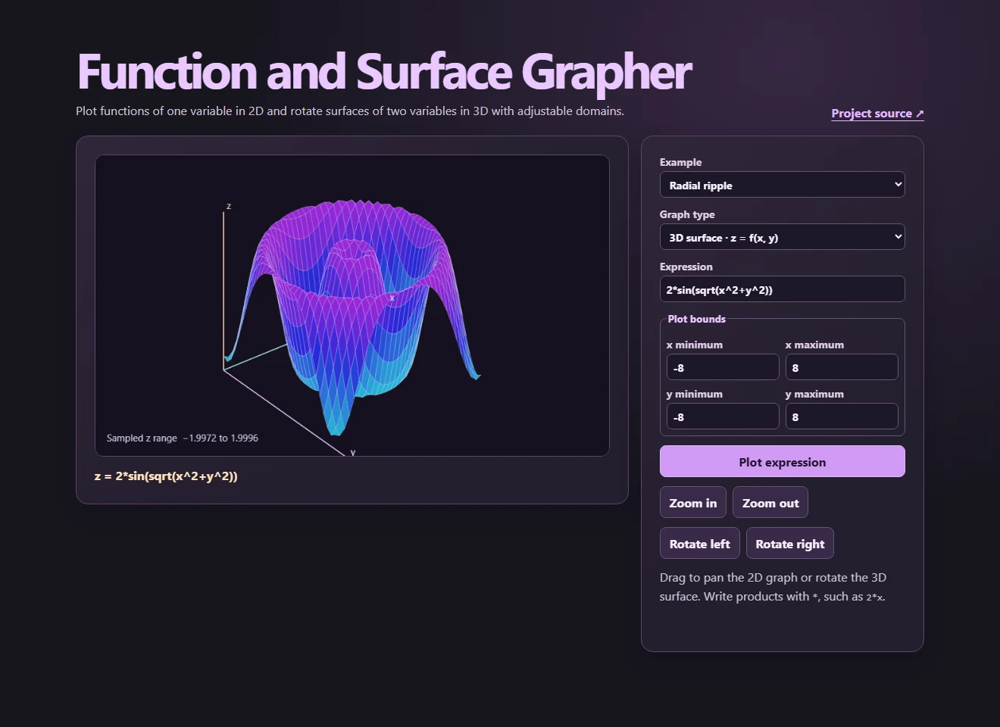

# Function and Surface Grapher

Plot functions of one variable in 2D and rotate surfaces of two variables in 3D with adjustable domains.

[Open the browser app](https://surfingcoder.com/apps/function-surface-grapher/)

## Run locally

Run the following command in this repository and open [localhost:8000](http://localhost:8000).

    python -m http.server 8000

Choose a curve or surface example, then enter an expression and set plot bounds. Curves treat y bounds as the visible value range. Surfaces treat y bounds as an input range and scale z to the finite sampled values.

Write explicit multiplication, such as 2*x, and use ^ for powers. Allowed functions are sin, cos, tan, sqrt, abs, exp, log, log10, asin, acos and atan. Trigonometric inputs are radians. The constants pi and e are available. The parser accepts only this mathematical grammar.

The zoom buttons narrow or widen the displayed bounds. Drag a curve to pan it, or drag a surface to rotate it. With the plot focused, the arrow keys pan a curve or rotate a surface. The range below the plot reports the current bounds and the sampled z range for surfaces.

Switching graph type keeps your expression and bounds. Use **Plot expression** to apply edits before panning or zooming. Invalid plots leave the last successful graph visible and show an error.

The grapher samples expressions numerically and probes for gaps. Very narrow features or discontinuities can still fall between samples. Narrow the bounds for a closer look.

## Verify

Run the following command with Node.js 22 or newer.

    node --test
